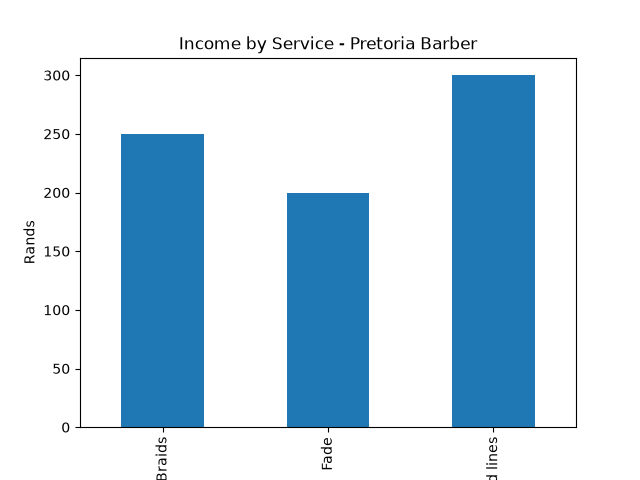

# 💈 Barber Shop Analytics Dashboard | Pretoria, SA
### Small Business Data Analytics | Python, Pandas, Matplotlib

## 📊 Project Overview
Built a data analytics tool for local barber shops in Pretoria to track income by service, identify top-earning services, and understand client retention.

**Problem:** Barbers track income on paper - no insights on which services make most money.
**Solution:** Python script that analyzes daily sales and visualizes profit drivers.

## 🚀 What It Does
- Calculates total income: R750+ sample
- Identifies busiest service (Freehand lines, Fade, Braids)
- Groups income by date and service type
- Generates bar chart for business decisions
- Ready to scale for US barber shops (USD conversion ready)

## 🛠️ Tech Stack
- Python 3
- Pandas (DataFrames, groupby)
- Matplotlib (data visualization)
- GitHub Portfolio

## 📈 Key Insights from Sample Data
- Top Service: Freehand lines = R300 (40% of revenue)
- Client Mix: 60% Regulars = retention opportunity
- Daily Average: R150

## 💼 How US Clients Can Use This
1. Replace sample data with real CSV from booking system
2. Track weekly trends, client types, peak days
3. Optimize pricing based on high-demand services

## 🔜 Next Features
- CSV upload from booking app
- USD/ZAR conversion
- Weekly email report
- Client retention dashboard

---
**Developer:** CodeNovaStudio2414 | IT Support + Data Analytics | CCNA | Pretoria, South Africa
**Seeking:** Remote Data Analyst roles for US small businesses
**Contact:** Via GitHub
